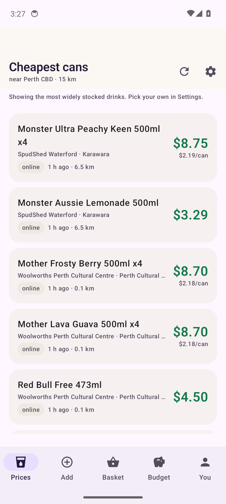
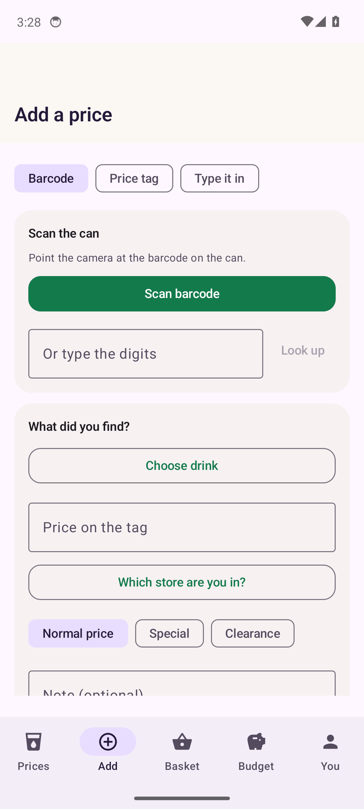
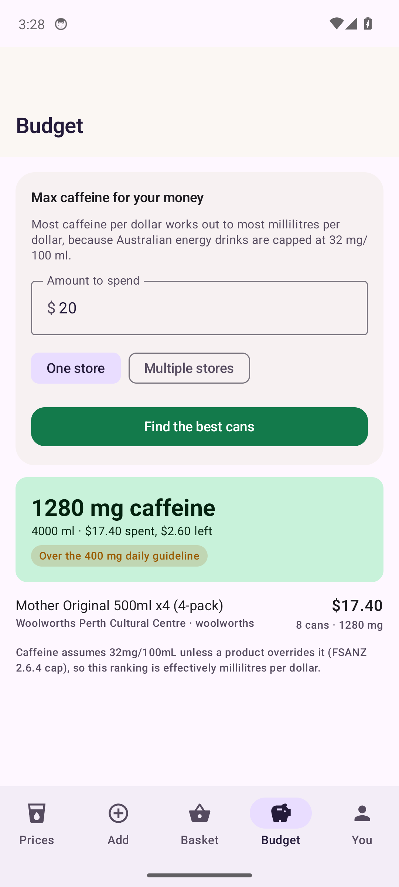
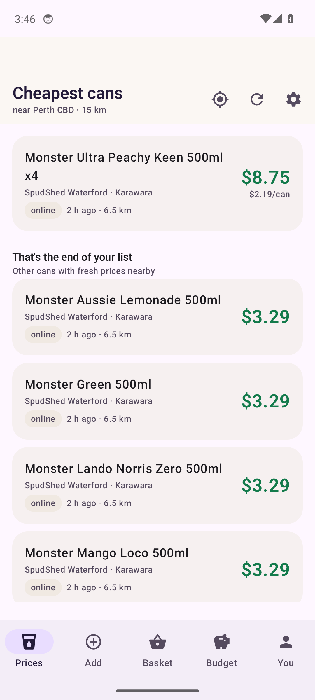
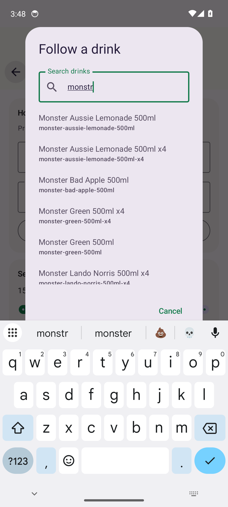
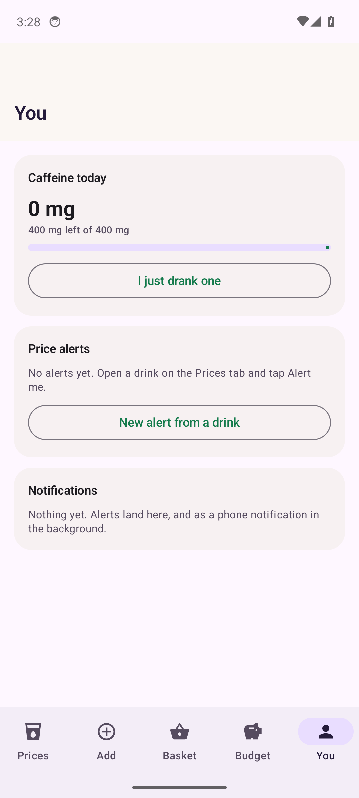

# DrinkWatch for Android

Cheapest energy drink prices near you, for Perth WA.

Companion app to the [DrinkWatch API](https://github.com/Blaroid/drinkwatch).
Supermarket prices come from the backend's scrapers; petrol-station and IGA
prices come from people using this app.

**Download:** https://cans.hazzardous.online/app (sideloaded APK, no Play Store)

| Prices | Add a price | Budget |
|---|---|---|
|  |  |  |

| Suggestions after your list | Typo-tolerant search | You |
|---|---|---|
|  |  |  |

## What it does

**Prices** - the cheapest can of each drink you follow, with per-can price, store,
distance and how old the price is. Tap a row for every store's price, "Navigate"
(hands off to Maps) and "Alert me". The list ends with
*"That's the end of your list"* and a few other cans nearby.

**Add** - three ways to contribute:

* **Barcode** - Play Services code scanner, or type the digits. Unknown barcodes
  open a "new can" form (name, brand, size) that queues the product for review.
* **Price tag** - photograph the shelf/fridge tag; ML Kit reads the text on device
  and a heuristic picks the sell price (skipping "was/save" and `$7.00 / 1L` unit
  prices). The photo is uploaded as evidence.
* **Type it in** - pick the drink and store from the fuzzy search.

**Basket** - add drinks and quantities; the API returns the cheapest legal mix of
singles, packs and multibuys at each store, the split-across-stores total, and a
drive plan with a FuelWatch-derived fuel cost and a "worth it?" verdict.

**Budget** - "most caffeine for my money" across one store or several, with the
400 mg/day guideline warning. (Because Australian energy drinks are capped at
32 mg/100 ml, this is effectively "most millilitres per dollar".)

**You** - caffeine log for today, price alerts, notifications.

**Widget** - home-screen widget with the four cheapest followed drinks, refreshed
every 30 minutes. The same background worker polls the API for price alerts and
raises local notifications.

## Architecture

    data/
      Api.kt            OkHttp + org.json client, one function per endpoint
      Models.kt         immutable models, parsed next to the endpoints
      Prefs.kt          EncryptedSharedPreferences: token, home location, radius,
                        tracked drinks, widget cache
      BasketStorage.kt  basket persisted as "slug:qty"
      Geo.kt            LocationManager helper + Maps intent
      PlaceName.kt      suburb/town for a coordinate (label default)
      Images.kt         decode, EXIF-rotate, downscale camera output
      Ocr.kt            ML Kit text recognition + shelf-price heuristic
    ui/
      Nav.kt            bottom-tab NavHost
      screens/          Home, Add, Basket, Budget, You, Settings
      components/       cards, chips, pickers (debounced fuzzy search)
      theme/            Material 3 palette
    widget/
      PriceWidget.kt    Glance widget
      WidgetRefresh.kt  WorkManager periodic refresh + alert polling

Deliberate choices:

* **No CameraX** - barcodes use the Play Services code scanner, price tags use the
  system camera via `TakePicture` (full resolution, EXIF-rotated) then ML Kit.
  Less code to get wrong than a camera pipeline.
* **org.json over kotlinx.serialization** - no compiler plugin or codegen for a few
  small payloads.
* **LocationManager over FusedLocationProvider** - works without Play Services.
* **Text recognition is the unbundled ML Kit model** (downloaded via Play Services
  on first use): the APK is 15 MB instead of 63 MB.
* **No ViewModels yet** - each screen owns its state with `remember`/effects.

## Building

Needs JDK 17 and Android SDK platform 35.

    ./scripts/build.sh assembleDebug       # debug APK
    ./scripts/build.sh assembleRelease     # signed with keystore.properties
    ./scripts/build.sh testDebugUnitTest   # JVM tests: price + OCR parsing

Release signing reads `keystore.properties` (gitignored):

    storeFile=keystore/drinkwatch.jks
    storePassword=...
    keyAlias=drinkwatch
    keyPassword=...

**Keep that keystore.** Lose it and no future APK can update an installed app. It
is backed up to the redmax disk.

## Releasing

1. Bump `versionCode` and `versionName` in `app/build.gradle.kts`.
2. `./scripts/build.sh assembleRelease`
3. Copy `app/build/outputs/apk/release/app-release.apk` to the server's
   `~/drinkwatch/apk/drinkwatch.apk` and update `version.json` there.
4. The API serves it at `/app` (install page), `/app/drinkwatch.apk` and
   `/app/version.json`.

## Version history

| Version | Change |
|---|---|
| 0.1.0 | first sideload build: prices, barcode + price-tag capture, basket, budget, alerts, caffeine log, widget |
| 0.1.1 | clean labels (no repeated brand/size) |
| 0.3.0 | "use my location" button; location label defaults to the suburb |
| 0.3.1 | end-of-list suggestions from `/v1/widget?suggest` |
| 0.3.2 | location title falls back to the default area, not "My location" |
| 0.3.3 | reload on resume; refresh right after tracking |
| 0.3.4 | picker rows show the clean label only |

## Privacy

* One anonymous **device token** (random, stored in EncryptedSharedPreferences) so
  crowd submissions can be attributed and moderated. No account, no email.
* **Location** is used only to compute distances and to name the place; it is
  stored on the device and sent as lat/lon on price queries.
* **Photos** are re-encoded server-side (EXIF including GPS stripped), capped at
  1600 px, and served by unguessable token.
* Nothing is shared with third parties. Scraped supermarket prices are indicative,
  not a quote.

## Not built (and why)

* **Android Auto** - Google's car app categories are navigation, POI, IOT,
  messaging, calling, weather, media and parked video/games/browsers. Price
  comparison is none of them, so review would reject it. The useful in-car move is
  the "Navigate to cheapest store" intent that already exists.
* **Wear OS** - next up: a Tile and a complication fed by the same `/v1/widget`
  payload, pushed from the phone over the Data Layer API.
* **Receipt scanning** - the API already has `/v1/receipts/parse`; the app flow
  (ML Kit on a docket, confirm a whole receipt at once) is the fastest way to add
  many prices and is the obvious next feature.

## Licence

Personal project; no licence granted for redistribution of the scraped price data.
